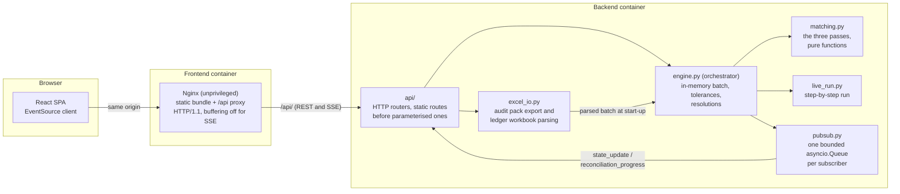

# reconcile-core-engine

[](https://github.com/d-gallardo-1/reconcile-core-engine/actions/workflows/ci.yml)

**On-premises multi-source reconciliation engine for ERP ledgers, bank feeds and tax
registries, with live progress over Server-Sent Events.**

> **Reference architecture demo.** The fictional entity *Veritas Ledger Systems — International
> Audit Division* and every counterparty, invoice and amount are synthetic. The service
> is not connected to any ERP, bank or tax authority, has no authentication, and keeps
> its state in memory. It shows how such an engine can be built; it is not a finished
> audit product. See [Honest scope](#honest-scope).

## The problem

Finance and audit teams cross-reference three sources that never line up by themselves:
the ERP general ledger, the bank settlement feed and the tax/VAT registry. Most of the
differences are harmless (a wire fee, a two-day clearing lag, an FX rounding penny) and
a few are not (an unrecorded tax retention, a payment made twice). Sorting one from the
other by hand in spreadsheets takes days.

This engine reads a batch, applies three deterministic passes, and leaves the auditor
with only the records that need a decision:

| Pass | Rule | Verdict |
| --- | --- | --- |
| 1 | One ERP entry, one bank settlement, verified registry record; identical amount, VAT and date | `EXACT_MATCH` |
| 2 | Same structure, variance and settlement shift inside the configured tolerances | `TOLERANCE_MATCH` |
| 3 | Everything left over, labelled with the most specific cause | `ANOMALY` |

An auditor's decision on an anomaly turns it into `RESOLVED`, with a UTC timestamp that
cannot be edited afterwards.

## What you can do in the demo

- Pick the **batch currency** (GBP, EUR, USD, CHF, BRL, MXN, CNY, INR, JPY, CLP) and the
  **interface language** (English, Spanish, Portuguese, Simplified Chinese, Japanese).
- Move the **amount tolerance** and **date window** (0–5 days). Nothing changes yet: the
  panel previews the effect ("2 records would become anomalies: TX-9010, TX-9012") and
  the rules take effect only when you press **Apply Rules**.
- **Search** the table by transaction, invoice or counterparty, and **sort** it by any
  column (amounts start with the largest; a third click returns to batch order).
- Start with **Largest Open Exposure**: the open anomalies ranked by the size of their
  variance, each with its share of the total at stake.
- Press **Run Live 3-Pass Reconciliation** and follow each record through the passes;
  the progress is streamed, so a second browser tab shows the same run.
- Inject four audit scenarios:

  | Code | Cause | Synthetic case |
  | --- | --- | --- |
  | `SCN-301` | `WITHHOLDING_GAP` | `INV-2026-881`: ERP 18,000.00 vs bank 16,200.00, no retention certificate |
  | `SCN-302` | `DUPLICATE_SETTLEMENT` | `INV-2026-884`: settled 2 × 3,450.00 against one ERP entry |
  | `SCN-303` | `ORPHAN_ERP_ACCRUAL` | `INV-2026-890`: 6,120.00 in ERP and registry, nothing in the bank feed |
  | `SCN-304` | `UNBOOKED_BANK_DEBIT` | `DD-4419`: 2,950.00 bank debit with no ERP entry |

- Open any record to compare the three sources side by side and, for an anomaly,
  **Approve Variance**, **Flag for Credit Note** or **Reject Entry** with an audit note.
- **Resolve several at once**: tick the anomalies of one cause in the table and apply
  a single decision and note to all of them. A selection that mixes causes is refused,
  and the operation is all or nothing.
- **Work through the list with the keyboard**: with a record open, ↑ and ↓ move to the
  previous and next record shown in the table, following its filter, search and order.
- **Export the .xlsx audit pack** (`Summary`, `Exact_Matches`, `Tolerance_Matches`,
  `Unresolved_Anomalies`, `Resolved_Audit_Trail`, `Ledger_Input`).
- In **Rule Engine & Schema Inspector**, download the input template, verify a workbook
  against the schema and, if it is valid, **load it as the active batch**. The batch
  then takes the workbook's currency. See the warning under [Honest scope](#honest-scope).
- Actions that replace the batch (reset, currency change, loading a workbook) **ask
  first** when there is something to lose, and say what: decisions, scenarios, an upload.
- **Audit Trail** lists every decision recorded in the batch, newest first.
- On a **narrow screen** the table becomes cards with a sort menu; nothing scrolls sideways.

The default batch holds 15 transactions: 9 exact matches, 3 tolerance matches and 3
anomalies, at the default tolerances (±15.00 in GBP, scaled for other currencies, and
±2 days). The amounts in the table above are the GBP figures.

## Quickstart

### With Docker

```bash
docker compose up --build
```

Then open <http://127.0.0.1:8081>. The port is 8081 so it does not collide with other
local demos on 8080.

### Without Docker

Requires Python 3.13+ and Node.js 20.19+. The container image and CI use Python 3.13;
see [verification status](docs/ARCHITECTURE_AND_SECURITY.md#8-verification-status) for
what was run where.

```powershell
# Windows. Unsigned scripts are blocked by default, so the policy is relaxed
# for this single run only.
powershell -ExecutionPolicy Bypass -File .\run_local.ps1
```

```bash
# Linux, macOS, WSL
./run_local.sh
```

Then open <http://127.0.0.1:5174> (backend on 8001).

### Tests

```bash
cd backend
python -m pip install -r requirements-dev.txt
python -m pytest -q

cd ../frontend
npm ci
npm test               # unit tests (Vitest + jsdom)
npm run build          # type check + production build
```

## Architecture



FastAPI runs as a single worker, so the in-memory batch is shared by every client.

- **One source of truth.** At start-up the synthetic batch is written to a workbook and
  parsed back through the same code path an uploaded ledger would take. A test proves
  that export followed by parsing returns identical transactions.
- **Exact money.** Amounts are `Decimal` inside the engine and rounded to the penny;
  variances are never computed with floats.
- **Every state event is a full snapshot.** A client that connects late or reconnects
  is consistent again after one message. A `heartbeat` event is sent after 5 seconds
  without any other event, so the browser can detect a dead connection.
- **Small modules.** No source file is longer than 200 lines;
  `scripts/check_file_length.py` enforces it in CI.

### Currencies and languages

- **Currency.** Every input row carries an ISO 4217 code and a batch holds exactly one
  currency. Amounts must fit the currency's smallest unit (no decimals for JPY or CLP),
  VAT is rounded to it, and the tolerance range scales with it.
- **Language.** The UI ships typed dictionaries (`frontend/src/i18n/messages/<code>/`).
  English defines the keys, so a missing key in another language fails the build. To add
  a language, write its two dictionary files and add one entry to `i18n/locales.ts`.
- **Backend text is code-based.** Verdict explanations and API errors carry a stable code
  and raw parameters; the UI turns them into a sentence in the active language and
  formats amounts with the browser's `Intl` API. The English sentence stays in the
  payload as a fallback and is what the Excel audit pack contains.
- No translation library and no external resources are used.

### API (`/api/v1`)

| Method | Path | Purpose |
| --- | --- | --- |
| GET | `/health` | Liveness and subscriber count |
| GET | `/batches/current` | Summary, KPIs, all records, active tolerances |
| GET | `/stream` | SSE: `snapshot`, `state_update`, `reconciliation_progress`, `heartbeat` |
| POST | `/batches/currency` | `{"currency": "JPY"}`: load the default batch in another currency |
| POST | `/reconcile/run` | Start a live 3-pass run (202). While it runs, every other change answers 409 |
| POST | `/reconcile/tolerance` | `{"amount_tolerance": 15, "date_window_days": 2}`; the limit depends on the currency |
| POST | `/reconcile/tolerance/preview` | Same body; returns what the rules would change (`newly_matched`, `newly_unmatched`, counts). Applies nothing |
| POST | `/reconcile/reset` | Restore the default batch and tolerances |
| POST | `/reconcile/inject/{scenario_code}` | Add `SCN-301` … `SCN-304` |
| POST | `/anomalies/{tx_id}/resolve` | `{"resolution_note": "...", "action": "APPROVE_VARIANCE"}` |
| POST | `/anomalies/resolve-batch` | `{"tx_ids": ["TX-9010", "TX-9012"], "action": "...", "resolution_note": "..."}`: one decision for up to 100 open anomalies of the same cause, all or nothing |
| GET | `/export/excel` | Download the audit pack |
| GET | `/export/template` | Download the `Ledger_Input` template |
| GET | `/schema/ledger` | Columns of the input sheet |
| POST | `/template/verify` | Validate a workbook (raw body, 2 MB limit); read-only |
| POST | `/batches/upload` | Load a workbook as the active batch (raw body, 2 MB limit; optional `X-Batch-Label` header). 422 with every problem listed when it is not valid |

More detail, including the security posture and what a real deployment would need:
[docs/ARCHITECTURE_AND_SECURITY.md](docs/ARCHITECTURE_AND_SECURITY.md).

## Honest scope

Built and covered by automated tests:

- The three matching passes and tolerance re-evaluation, including boundary values.
- Scenario injection, the resolution workflow (immutability included) and reset.
- Excel export, round-trip parsing, malformed-workbook reporting (out-of-range numbers
  and the row limit included) and formula-safe text.
- The SSE stream: initial snapshot, broadcast to several subscribers, heartbeat and the
  ordered progress of a live run, and a run that fails midway being reported as failed.

Frontend unit tests cover the logic that can go wrong silently: the live-run state, the
stream reconnection rules, the tolerance draft, number and currency formatting, API error
handling, and that every language has the same keys and placeholders as English. The
components' layout and the full screens are not tested automatically; they were exercised
by hand in a browser.

Deliberately not built:

- **No authentication or user identity.** A resolution records *when*, not *who*.
- **No persistence.** State lives in memory and is lost on restart; "immutable" means
  the API refuses to change a decision, not that it is stored in tamper-evident form.
- **No real connectors.** Nothing reads from an ERP, a bank or a tax authority. A
  workbook can be loaded by hand as the active batch, and that is all.
- **Do not load confidential data.** A loaded batch is held in memory, is shown to
  every browser connected to the engine, has no access control and is lost on restart.
  The feature exists to try the engine with your own shape of data, using made-up rows.
- **Simplified matching.** One row already pairs the three sources by invoice
  reference. Real reconciliation also has to find those pairs (many-to-one payments,
  partial settlements, missing references), which this demo does not attempt.
- **Simplified tax model.** One VAT rate per invoice and a single registry status. It
  is not tax advice and does not model any jurisdiction's rules.
- **One currency per batch, no FX.** A batch is reconciled in a single currency and a
  workbook that mixes currencies is refused. There is no conversion between currencies:
  switching currency re-denominates the synthetic batch with a fixed illustrative factor,
  not a market rate.
- **Partly translated.** The interface is translated; the Excel audit pack, workbook
  validation messages and the schema table stay in English. The Spanish, Portuguese,
  Chinese and Japanese texts were machine-written and have not been reviewed by native
  speakers.

## License

MIT. See [LICENSE](LICENSE).
